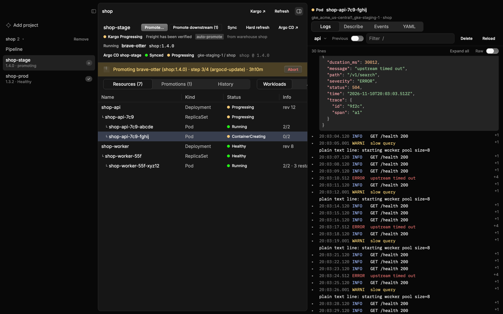

<p align="center">
  
</p>

<h1 align="center">kargoslop</h1>

<p align="center">
  <a href="https://github.com/vangheem/kargoslop/releases/latest"></a>
  <a href="https://github.com/vangheem/kargoslop/actions/workflows/ci.yml"></a>
  <a href="LICENSE"></a>
</p>

A native desktop app that puts Kargo, Argo CD and Kubernetes in one window. Pick a Kargo
project, see its pipeline and freight, promote, then follow the promotion down to the
Argo CD app it syncs and the pods it rolls out: their logs, rollout status, events and YAML.
It's built with [Rune](https://github.com/anomalyco/rune), like
[gitsnack](https://github.com/vangheem/gitsnack).



## Features

**Pipeline** (per Kargo project)
- Each warehouse with its stages in promotion order, and what each stage runs.
- A freight × stage matrix: where each piece of freight runs, where it was verified, and a
  **promote** button wherever Kargo would accept it.
- **Discover now** refreshes a warehouse.

**Stage**
- Kargo health and readiness, the running freight, and the stage's Argo CD apps with their
  sync and health status, cluster, namespace and sources.
- **Promote…** picks freight (newest first, showing what's eligible), **Promote downstream**
  sends the current freight to the next stages, and **Abort** stops a running promotion. A
  banner tracks the running promotion step by step.
- **Resources**: the Argo CD resource tree (Deployments → ReplicaSets → Pods, Jobs, …) with
  live health, containers, restarts and images. It refreshes every 4 seconds, so a rollout
  plays out in front of you. Use **All** to include services, config and old ReplicaSets.
- **Promotions**: each promotion's steps, timing and errors. **History**: the freight the
  stage ran, with verification results.
- **Sync** and **Hard refresh** for the Argo CD app, and links to the Kargo and Argo CD UIs.

**Resource panel** (k9s-style)
- **Logs**: follows a pod's logs, or all pods of a Deployment, StatefulSet or Job. JSON lines
  show their time, level and message, and expand to the whole object, pretty and highlighted.
  Pick the container (sidecars are skipped by default), turn on **Previous** for the last
  crashed container, or **Raw** for the lines as they are.
- **Rollout**: watches `kubectl rollout status`. **Restart** does a rollout restart and
  switches to the rollout watch.
- **Describe** as a summary of fields and collapsible sections (each container, conditions,
  volumes) with status words coloured; **Events** as cards, newest first, with warnings outlined;
  **YAML** syntax-highlighted; **Delete** for pods.
- Filter any of these as you type.

## How it connects

kargoslop holds no credentials of its own. It uses the CLIs you're already logged in with:

| Tool | Used for |
| --- | --- |
| `kargo` | projects, warehouses, stages, freight, promotions; promoting |
| `argocd` | app status, sync, refresh; the resource tree through Argo CD's API with the CLI's saved token |
| `kubectl` | logs, rollout status, describe, events, YAML, restart, delete |

Each stage names its Argo CD apps in its health status. Each app names its destination
cluster, which is matched to a kube context ending in that name: Argo CD's
`eks-prod-1` matches `arn:aws:eks:…:cluster/eks-prod-1`, and `gke-staging-1`
matches `gke_project_region_gke-staging-1`. If a cluster's context is named differently, map
it in the state file:

```json
{ "contexts": { "gke-staging-1": "my-stage-context" } }
```

## Requirements

- [`kargo`](https://docs.kargo.io/user-guide/installing-the-cli/), logged in
  (`kargo login https://kargo.example.com --sso`).
- [`argocd`](https://argo-cd.readthedocs.io/en/stable/cli_installation/), logged in
  (`argocd login argocd.example.com --sso --grpc-web`).
- `kubectl`, with contexts for the clusters Argo CD deploys to (a recent version, for logs
  across all of a workload's pods).

macOS is the main target. Linux builds are provided too; the Mac app bundle is macOS only.

## Install

### Homebrew (macOS and Linux x86_64)

```sh
brew install vangheem/tap/kargoslop
```

Upgrade with `brew upgrade kargoslop`.

#### As a Mac app

```sh
kargoslop install-app      # creates ~/Applications/kargoslop.app
kargoslop uninstall-app    # removes it
```

kargoslop also offers to do this the first time you start it from a terminal. Then open it
from Spotlight, Launchpad or the Dock like any other app.

The app is created on your Mac rather than downloaded, so macOS doesn't block it even though
kargoslop isn't signed. It runs the installed `kargoslop` through Homebrew's
version-independent path, so `brew upgrade` updates the app too, and it picks up your login
shell's `PATH`, so it finds `kargo`, `argocd`, `kubectl` and kubectl's auth plugins
(`gke-gcloud-auth-plugin`, `aws`) when opened from Finder.

### Prebuilt binaries

Tagged releases (`v*`) are on the [releases page](https://github.com/vangheem/kargoslop/releases),
and every push to `main` refreshes the
[`latest` prerelease](https://github.com/vangheem/kargoslop/releases/tag/latest).

| Platform | Asset |
| --- | --- |
| macOS (Apple silicon and Intel) | `kargoslop-macos-universal.tar.gz` |
| Linux x86_64 | `kargoslop-linux-x86_64.tar.gz` |

```sh
curl -L https://github.com/vangheem/kargoslop/releases/latest/download/kargoslop-macos-universal.tar.gz | tar xz
mkdir -p ~/.local/bin && mv kargoslop ~/.local/bin/
```

The binaries aren't signed. Homebrew and `curl` installs work as is; if you download one with
a browser, macOS quarantines it, so clear that with
`xattr -d com.apple.quarantine ~/.local/bin/kargoslop`.

On Linux, `libxkbcommon-x11-0` and a Vulkan driver (e.g. `mesa-vulkan-drivers`) must be
installed.

### From source

Requires Rust; the toolchain version is pinned in `rust-toolchain.toml`, so rustup picks
it up automatically.

```sh
make install          # builds a release binary into ~/.local/bin/kargoslop
make install PREFIX=/usr/local
```

Linux builds also need `libxkbcommon-dev` and `libwayland-dev`.

## Use

Run `kargoslop`, click **Add project**, and pick a Kargo project.

| Key | Action |
| --- | --- |
| ⌘R | Refresh everything |
| ⌘I | Show or hide the resource panel |
| ⇧⌘B | Show or hide the sidebar |
| l / r / d / e / y | Logs, rollout, describe, events, YAML for the selected resource |
| / | Filter |

## Data

`~/.local/share/kargoslop/state.json` (or `$XDG_DATA_HOME/kargoslop`): the projects you
added, any cluster → context mappings, and whether to offer the Mac app.

## Releasing

Run the **Release new version** workflow from the Actions tab (or
`gh workflow run bump-version.yml -f bump=patch`) and pick `patch`, `minor` or `major`.
It bumps the version in `Cargo.toml` and `Cargo.lock`, commits to `main`, and pushes a
`vX.Y.Z` tag. The tag starts the release workflow, which builds the binaries, publishes the
GitHub release and updates the formula in
[vangheem/homebrew-tap](https://github.com/vangheem/homebrew-tap).

Tagging by hand works too, as long as the tag matches the version in `Cargo.toml`.

## Development

```sh
make test                                       # offline tests
KARGO_PROJECT=my-project ARGO_APP=my-app cargo test -- --ignored  # against your own setup
cargo run -- --snap out.png --scene demo --size 1600x960 --theme dark
```

- `src/main.rs`: app state, background jobs, polling and actions.
- `src/view.rs`: window, sidebar, toolbar, dialogs; `src/pipeline.rs`, `src/stage.rs`,
  `src/inspector.rs`: the pipeline, stage and resource panel views.
- `src/kargo.rs`, `src/argo.rs`, `src/kube.rs`: the three backends; `src/format.rs` parses
  logs and `kubectl describe` for display.
- `src/appbundle.rs`: `kargoslop install-app`.

## License

MIT
